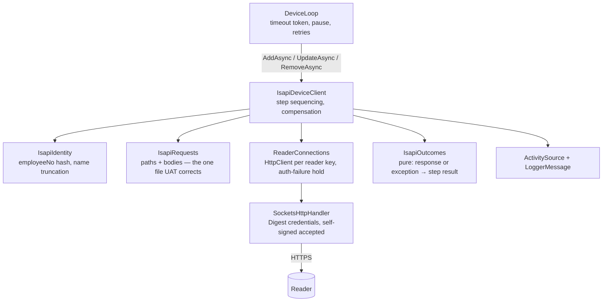

# isapi-device-client Design

**Spec**: `.specs/features/isapi-device-client/spec.md`
**Context**: `.specs/features/isapi-device-client/context.md`
**Status**: Draft

---

## Architecture Overview

The adapter is a plain `IDeviceClient` in `Infrastructure/Isapi/`, chosen at startup by
`DeviceClient:Adapter = Isapi`. It owns no retries, timeouts or pausing; those stay in
`DeviceLoop` (AD-043). Each port call is a short, fixed sequence of ISAPI **steps**. Each step's
answer is classified by a pure function, and the call's outcome is the first non-success step,
apart from the two places where the sequence continues (upsert on "already exists",
compensation after a refused face).

Approach chosen with the user: **one `SocketsHttpHandler` per reader, using .NET's built-in
digest**, cached by endpoint identity. Rejected: a shared handler with our own digest
implementation (we would own an auth protocol), and a handler per call (a TLS handshake on the
reader's embedded CPU on every enrolment works against AD-014).

---

## Code Reuse Analysis

### Existing Components to Leverage

| Component | Location | How to Use |
| --- | --- | --- |
| `IDeviceClient`, `Delivered` / `Rejected` / `Unreachable` | `Shared/IDeviceClient.cs`, `Shared/DeviceCallOutcomes.cs` | Implemented unchanged, except `DeviceEnrolment` gains `Name` |
| `DeviceLoop` timeout and cancel mapping | `Infrastructure/Worker/DeviceLoop.cs:281`, `:310` | Already maps the deadline's `OperationCanceledException` to `Unreachable` (WRK-11). ISA-20 relies on it, so the adapter just lets cancellation propagate |
| `DeviceLoop.EnrolmentOf` | `Infrastructure/Worker/DeviceLoop.cs:340` | Adds `user.Name` (ISA-26) |
| Adapter selection | `Infrastructure/DeviceClientOptions.cs`, `Program.cs:58-70` | Add `IsapiAdapter = "Isapi"`; the validator accepts it; the factory switch resolves it |
| Validated options pattern (AD-033) | `Infrastructure/FaceImageOptions.cs` | Template for `IsapiOptions` + `IsapiOptionsValidator`, `ValidateOnStart()` |
| Own `ActivitySource`, registered by name | `SkiaFaceImageNormalizer.ActivitySourceName`, `Program.cs:144` | Same pattern for ISA-28; no HTTP-instrumentation package is added |
| `[LoggerMessage]` source-generated logs | `DeviceLoop.cs` | Same pattern for ISA-29 |
| `WorkerPostgresFixture.StartIsolatedHostAsync(settings)` | `IntegrationTests/WorkerPostgresFixture.cs:77` | Host with the worker on and `Adapter = Isapi`, on its own database |
| `InMemoryLogSink`, `CredentialLeakageTests` | `IntegrationTests/CredentialLeakageTests.cs` | Extended for ISA-24 |
| `TracingTests`, `StartupTests` | `IntegrationTests/` | Extended for ISA-28 and ISA-23 |

### Integration Points

| System | Integration Method |
| --- | --- |
| Replication worker | Unchanged contract. Gains `Name` in `DeviceEnrolment` |
| Reader | HTTPS + digest, ISAPI JSON / multipart |
| OpenTelemetry | `AddSource(IsapiDeviceClient.ActivitySourceName)` inside the existing tracing block |
| Database | None. The adapter is stateless with respect to persistence |

---

## Components

### `DeviceEnrolment.Name` (port change)

- **Purpose**: Carry the spectator's name to the reader (ISA-26, ISA-27).
- **Location**: `Shared/IDeviceClient.cs`
- **Interfaces**: `record DeviceEnrolment(string ExternalRef, string Name, string AccessCode, ReadOnlyMemory<byte> FacePicture)`
- **Reuses**: `FakeDeviceClient` stores the whole enrolment, so ISA-27 needs no fake change beyond compiling. A `DeliveryTests` assertion proves it.

### `IsapiOptions` + `IsapiOptionsValidator`

- **Purpose**: Every ISAPI constant that the UAT may correct lives in configuration, not code (AD-033).
- **Location**: `Infrastructure/Isapi/IsapiOptions.cs`, section `Isapi`
- **Fields** (defaults):
  - `NameMaxLength` = 32 — A-6. *Unverified*; replaced by the UAT measurement (ISA-36).
  - `FaceLibraryId` = `"1"`, `FaceLibraryType` = `"blackFD"` — A-1.
  - `DoorNo` = 1, `PlanTemplateNo` = `"1"`, `ValidFrom` = `2000-01-01T00:00:00`, `ValidTo` = `2037-12-31T23:59:59` — A-8.
  - `AlreadyExistsSubStatusCodes` = `["deviceUserAlreadyExist"]` — ISA-02 (community-evidenced).
  - `AbsentSubStatusCodes` = `[]` — ISA-11. **Unknown until UAT**; the stub tests configure their own code.
  - `ConnectionLifetime` = 5 min — `PooledConnectionLifetime`.
  - `AuthFailureHold` = 30 min — ISA-37.
- **Validator**: positive lengths and durations, `ValidFrom < ValidTo`, non-blank library id and type.

### `IsapiIdentity` (pure)

- **Purpose**: A-2 and ISA-26.
- **Location**: `Infrastructure/Isapi/IsapiIdentity.cs`
- **Interfaces**:
  - `static string EmployeeNo(string externalRef)` — lowercase hex of `SHA256(UTF8(externalRef))[0..16]`.
  - `static string TruncateName(string name, int max)` — cuts on a text-element boundary (`StringInfo`), so a surrogate pair or combining mark is never split.

### `IsapiRequests`

- **Purpose**: The **only** file that knows ISAPI paths and body shapes. When the UAT corrects A-1 or A-7, this is the file that changes.
- **Location**: `Infrastructure/Isapi/IsapiRequests.cs`
- **Steps** (each returns an `HttpRequestMessage`):

| Step | Request | Status |
| --- | --- | --- |
| `PersonCreate` | `POST /ISAPI/AccessControl/UserInfo/Record?format=json` — `{ "UserInfo": { employeeNo, name, userType:"normal", Valid:{enable:true, beginTime, endTime}, doorRight:"1", RightPlan:[{doorNo, planTemplateNo}], password: PIN } }` | path: community; `password` as PIN: *unverified* (A-7) |
| `PersonModify` | `PUT /ISAPI/AccessControl/UserInfo/Modify?format=json` — same body | community |
| `PersonDelete` | `PUT /ISAPI/AccessControl/UserInfo/Delete?format=json` — `{ "UserInfoDelCond": { "EmployeeNoList": [{ employeeNo }] } }` | body *unverified* |
| `FaceDelete` | `PUT /ISAPI/Intelligent/FDLib/FDSearch/Delete?format=json&FDID={id}&faceLibType={type}` — `{ "FPID": [{ "value": employeeNo }] }` | body *unverified* |
| `FaceCreate` | `POST /ISAPI/Intelligent/FDLib/FaceDataRecord?format=json`, multipart: part `FaceDataRecord` = `{ faceLibType, FDID, FPID: employeeNo }`, then part `FaceImage` (`image/jpeg`) | community: part order is strict |

### `IsapiOutcomes` (pure)

- **Purpose**: The single classification rule (A-4), ISA-12…ISA-18 and ISA-25.
- **Location**: `Infrastructure/Isapi/IsapiOutcomes.cs`
- **Interfaces**:
  - `static StepResult Classify(IsapiStep step, HttpStatusCode status, string body, IsapiOptions options)`
  - `static StepResult Classify(IsapiStep step, HttpRequestException exception)` — maps `HttpRequestException.HttpRequestError` (`NameResolutionError`, `ConnectionError`, `SecureConnectionError`, `ResponseEnded`, …) to `Unreachable` with that class name as reason (ISA-14).
- **`StepResult`**: `Ok | AlreadyExists | Absent | Refused(reason) | ReaderDown(reason) | AuthFailed(reason, unlockAt?)`.

| Answer | Result |
| --- | --- |
| 2xx, `statusCode` 1 | `Ok` |
| `subStatusCode` ∈ `AlreadyExistsSubStatusCodes` | `AlreadyExists` |
| `subStatusCode` ∈ `AbsentSubStatusCodes` | `Absent` |
| 401 / 403 | `AuthFailed("authentication failed")`, or `"account locked"` + unlock time when the body says so (it may be XML; parsed tolerantly) |
| 404 / 405 | `ReaderDown("{path} not supported")` |
| 5xx | `ReaderDown("HTTP {status}")` |
| a parseable `ResponseStatus` with `statusCode` ≠ 1, any other status | `Refused("{step}: {subStatusCode} ({errorCode}) {errorMsg}")` |
| anything unparseable | `ReaderDown("unrecognised response, HTTP {status}")` |

  The reason is assembled only from those fields, never from a raw body (ISA-25). `errorMsg` is
  capped at 200 characters.

### `ReaderConnections`

- **Purpose**: One warm, digest-authenticated `HttpClient` per reader, plus the auth-failure hold (ISA-37).
- **Location**: `Infrastructure/Isapi/ReaderConnections.cs`, singleton, `IDisposable`
- **Interfaces** (`IReaderConnections`, so unit tests can supply a scripted handler):
  - `HttpClient For(DeviceEndpoint endpoint)`
  - `bool IsHeld(DeviceEndpoint endpoint, out string reason)` / `void Hold(DeviceEndpoint endpoint, string reason, DateTimeOffset until)`
- **Key**: `(DeviceId, IpAddress, Port, Username, SHA-256(Password))`. No plaintext password in the key. A new key for a `DeviceId` disposes that device's previous client. That is safe because WRK-06 means no other call is in flight on it, and WRK-33 reloads the endpoint before each call.
- **Handler**: `SocketsHttpHandler { Credentials = CredentialCache { (base, "Digest", NetworkCredential) }, PreAuthenticate = false, AllowAutoRedirect = false, PooledConnectionLifetime = options.ConnectionLifetime, SslOptions.RemoteCertificateValidationCallback = accept }`. `HttpClient { BaseAddress = https://ip:port/ (bracketed IPv6 via UriBuilder), Timeout = Infinite }`, so only the worker's token governs time. Using `CredentialCache` with `"Digest"` means the handler never falls back to Basic.
- **Hold (ISA-37)**: after `AuthFailed`, the key is held until `unlockAt` if the reader gave one, otherwise for `AuthFailureHold`. Calls on a held key return `Unreachable(reason)` **without contacting the reader**. Changing the device's credentials yields a new key, so the hold ends at once. The hold uses the injected `TimeProvider` (AD-023).

### `IsapiDeviceClient : IDeviceClient`

- **Purpose**: Step sequencing, compensation, tracing and logging.
- **Location**: `Infrastructure/Isapi/IsapiDeviceClient.cs`
- **Dependencies**: `IReaderConnections`, `IOptions<IsapiOptions>`, `TimeProvider`, `ILogger<IsapiDeviceClient>`
- **Sequences** (each arrow is one authenticated exchange; the first non-`Ok` stops the call unless noted):

| Operation | Steps | Notes |
| --- | --- | --- |
| Add | `PersonCreate` → (`AlreadyExists` ⇒ `PersonModify`) → `FaceDelete` (`Absent` = ok) → `FaceCreate` | `Refused` at either face step ⇒ `PersonDelete` (compensation), then `Rejected` (ISA-04/05). `ReaderDown` or auth failure at a face step ⇒ `Unreachable`, no compensation (ISA-06) |
| Update | same person upsert → `FaceDelete` → `FaceCreate` | No compensation (ISA-09) |
| Remove | `FaceDelete` → `PersonDelete` | `Absent` = ok at both (ISA-11). The face goes first, so a person is never left holding a face after a partial remove (ISA-10) |

- **Cancellation (ISA-20)**: `ThrowIfCancellationRequested()` before each step. An `OperationCanceledException` raised while the token is cancelled is rethrown, and compensation is skipped. A `TaskCanceledException` without the token cancelled cannot happen (`Timeout = Infinite`), but is classified `ReaderDown` defensively.
- **ISA-19**: no step is re-sent. The digest challenge round-trip is part of one authenticated exchange, not a retry.
- **Tracing (ISA-28)**: `ActivitySource("HikvisionReplicator.Isapi")`, one `Client` activity per step, tagged `device.id`, `isapi.step`, `http.response.status_code`, `isapi.sub_status_code`. No URL query values or bodies.
- **Logging (ISA-29)**: one `[LoggerMessage]` per call: device id, operation, outcome, failing step, HTTP status, `subStatusCode`, elapsed ms. Information for `Delivered`, Warning otherwise.

### Wiring

- `DeviceClientOptions.IsapiAdapter = "Isapi"`. The validator accepts `Fake` and `Isapi`, and its failure message names both (ISA-23).
- `Program.cs`: register `IsapiOptions` (bind, validator, `ValidateOnStart`), `ReaderConnections` as `IReaderConnections`, `IsapiDeviceClient`; extend the adapter switch; `AddSource(IsapiDeviceClient.ActivitySourceName)`.

---

## Testing Strategy (confirmed with the user)

| Level | Project / class | Covers |
| --- | --- | --- |
| unit | `Tests/Infrastructure/Isapi/IsapiOutcomesTests` | ISA-12…ISA-18, ISA-25 — one row per table entry above, reasons pinned as **literals** (test-patterns trap 1) |
| unit | `Tests/Infrastructure/Isapi/IsapiIdentityTests` | A-2 with a pinned hash vector; ISA-26 truncation, including a surrogate pair at the cut |
| unit | `Tests/Infrastructure/Isapi/IsapiDeviceClientTests` | ISA-01…ISA-11, ISA-19, ISA-20, ISA-37 sequencing over a scripted `HttpMessageHandler` (no socket); asserts the exact request sequence and outcome |
| unit | `Tests/Infrastructure/Isapi/IsapiOptionsValidatorTests`, `DeviceClientOptionsValidatorTests` | options bounds; ISA-23 message |
| integration | `IntegrationTests/StubReader` (helper) | Kestrel on `127.0.0.1:0`, HTTPS with an in-memory self-signed certificate, **real digest challenge and verification**, persons and faces in memory, scriptable status per step and an "offline" switch |
| integration | `IsapiDeliveryTests` (situation class on `WorkerPostgresFixture`, isolated host, `Adapter = Isapi`) | ISA-01, ISA-07, ISA-10, ISA-21, ISA-26 end to end: `PUT /api/users` → the stub holds the hashed person with name and PIN and the face bytes; update; delete |
| integration | `IsapiReaderFailureTests` | wrong password ⇒ paused, zero dead letters, **exactly one** failed login at the stub across the probes (ISA-15, ISA-37); stub refuses the face ⇒ dead letter after `MaxAttempts`, no person left (ISA-04); stub offline ⇒ backlog drains on return |
| integration | `CredentialLeakageTests` (+) | ISA-24: logs, spans and `LastError` across the success, reject and auth-fail flows contain neither the device password, the PIN, nor `Authorization` |
| integration | `StartupTests` (changed) | ISA-23: `Isapi` starts, an unknown name fails naming both; ISA-22: an `HttpClient` from the host's DI fails TLS against the stub while the adapter succeeds |
| integration | `TracingTests` (+) | ISA-28 spans and tags |
| integration | `DeliveryTests` (+) | ISA-27: the fake received the user's name |
| manual | `validation.md` § UAT | ISA-30…ISA-36 on the DS-K1T342MFWX |

---

## Error Handling Strategy

| Error Scenario | Handling | User Impact |
| --- | --- | --- |
| Reader offline, DNS, TLS failure | `Unreachable(class)` | Reader paused by the worker; backlog drains on return |
| Wrong credentials / account locked | `Unreachable`, key held (ISA-37) | Reader paused; one failed login per credential change; no lockout; fixed by `PUT /api/devices/{id}` |
| Firmware lacks an endpoint (404/405) | `Unreachable(path)` | Reader paused until firmware or adapter is fixed; nothing dead-lettered |
| Reader refuses one spectator | `Rejected(subStatus…)` | That spectator retried with backoff, then dead-lettered (WRK-16/17) |
| Face refused on Add | compensating delete, then `Rejected` | Never PIN-only on the reader |
| Worker deadline mid-call | `OperationCanceledException` propagates | `Unreachable` (WRK-11); the retry converges a half-written person (ISA-02) |

---

## Risks & Concerns

| Concern | Location (file:line) | Impact | Mitigation |
| --- | --- | --- | --- |
| **Probes would lock the reader's account.** Pause after 2 failures, then probes at 5 / 10 / 20 s = 5 failed logins in ~35 s; the reader locks after ~5 (community). | `Infrastructure/Worker/ReplicationWorkerOptions.cs:45-52` | ISA-34 fails; a typo'd password locks the admin account for ~30 min | **ISA-37**: the adapter holds refused credentials and answers `Unreachable` locally until they change or the hold lapses. Added to the spec at design time. |
| An existing test asserts `Isapi` is **rejected** at startup | `IntegrationTests/StartupTests.cs:127-134` | It turns red by design | Rewritten under ISA-23 (unknown name `Bogus` still rejected; `Isapi` accepted). This is a superseded criterion, not a weakened test. |
| ISAPI paths, bodies, PIN field and absent/exists codes are *unverified* on the DS-K1T342 | `IsapiRequests.cs`, `IsapiOptions` | Stub-green but bench-red | All shapes live in one file plus options. The UAT (ISA-36) runs before validation closes, and corrections are fix tasks. `AbsentSubStatusCodes` ships empty and is filled from the UAT. |
| Face replace is delete-then-create, so a refused new face on **Update** leaves the spectator PIN-only | `IsapiDeviceClient` Update sequence | Between a refused update and its dead letter, that spectator enters by PIN only | ISA-09 accepts this (no person delete). The UAT also probes `FDLib/FDSetUp` (official: "add or overwrite"); if the DS-K1T342 supports it, the face write switches to it and keeps the old face on refusal. |
| Digest challenge on every request: 2 round-trips, and the ~200 KB face may be sent twice | `ReaderConnections` handler | Extra latency per enrolment against AD-038's p95 < 30 s | The UAT records per-step durations (ISA-29 log). If material, revisit the rejected "own digest with nonce reuse" approach as a follow-up. |
| Plaintext device password lives in the handler's `CredentialCache` for the process lifetime | `ReaderConnections` | Memory disclosure only; never logged | Same exposure as the existing `DeviceEndpoint` (AD-008). Keys hold a hash, not the password. Disposed on endpoint change and on shutdown. |
| Accept-all certificate callback | `ReaderConnections` handler | Active MITM on the reader LAN can read faces and PINs | Scoped to this handler only, and proven by ISA-22's test. Pinning is a recorded deferred idea. |

---

## Tech Decisions (only non-obvious ones)

| Decision | Choice | Rationale |
| --- | --- | --- |
| Digest | Built-in `SocketsHttpHandler` via `CredentialCache` `"Digest"` | No hand-written auth protocol. Digest-only, never Basic. Confirmed with the user. |
| Person upsert | `Record`, then `Modify` on "already exists" | Uses the two best-evidenced calls. `UserInfo/SetUp` is official but unconfirmed on this firmware, and a 404 fallback would contradict A-4. |
| Face write | `FDSearch/Delete` (absent = ok), then `FaceDataRecord` | Only the best-evidenced calls (a community report saw `FDSetUp` 404 on another model); revisited at UAT. |
| Tracing | Own `ActivitySource`, no `OpenTelemetry.Instrumentation.Http` | Step-level tags, full control that no URL or header is recorded, no new package. Same pattern as the normalizer. |
| Auth-failure hold | Adapter-local, keyed by credential fingerprint | Credentials do not fix themselves. The worker's pause is generic and must not learn about logins (AD-017 keeps protocol out of the engine). |

No new project-level decision: everything conforms to AD-002, AD-017, AD-023, AD-024, AD-026,
AD-033, AD-036 and AD-043.
