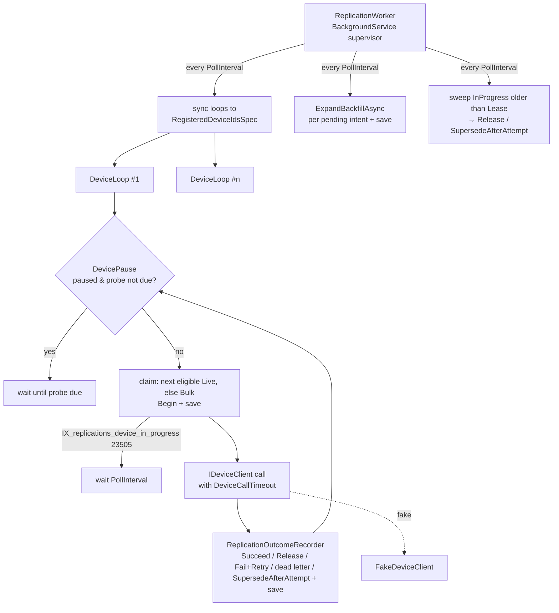

# replication-worker Design

**Spec**: `.specs/features/replication-worker/spec.md`
**Context**: `.specs/features/replication-worker/context.md`
**Status**: Approved — implemented and validated (PASS, iteration 3)

---

## Architecture Overview

A `BackgroundService` **supervisor** keeps one long-running **device loop** per registered device
(WRK-10). Each loop is serial — claim → call → record — so one operation per device holds by
construction inside an instance, and a partial unique index makes it hold across instances
(WRK-06). The supervisor also expands backfill intents (WRK-04) and sweeps expired leases (WRK-22).
Each loop owns an in-memory **`DevicePause`** — a consecutive-failure breaker, not Polly (AD-043
as amended). Every database write goes through a fresh DI scope and the aggregate's own
transitions; no raw SQL updates the queue.



### Approach chosen

| Topic | Choice | Rejected |
| --- | --- | --- |
| Topology | One loop per device under a supervisor | Central dispatcher batching across devices — pause and fairness would be rebuilt inside a batch query (user confirmed) |
| Device pause | Own `DevicePause`, ~40 lines | Polly v8: ratio-only breaker; no window satisfies both a 10 s timeout and a fast refusal (user confirmed; AD-043 amended) |
| Claim | Load next eligible through a spec, `Begin`, save; the device index arbitrates | `UPDATE … FOR UPDATE SKIP LOCKED` raw SQL — bypasses the aggregate (AD-005) and specs (AD-006); per-device exclusivity still needs the index |

---

## Code Reuse Analysis

### Existing Components to Leverage

| Component | Location | How to Use |
| --- | --- | --- |
| `Replication` transitions | `Domain/Replication.cs:92-127` | `Begin`, `Succeed`, `Fail`, `Retry` used as is; extended below |
| `ExpandBackfillAsync` | `Infrastructure/ReplicationFanOut.cs:131` | Called by the supervisor, then one save (AD-041) |
| `RegisteredDeviceIdsSpec` | `Domain/Specs/RegisteredDeviceIdsSpec.cs` | Supervisor's loop-set source |
| `PendingReplicationsForUserSpec` pattern | `Domain/Specs/` | Template for the new worker specs |
| `IReplicationRepository.TranslateIfDuplicatePending` | `Shared/IReplicationRepository.cs` | Detects a newer intent arriving during an outcome save (WRK-20) |
| `IEncryptionService` | `Shared/IEncryptionService.cs` | Decrypt device password for the call (AD-008) |
| `ReplicationMetrics` | `Infrastructure/ReplicationMetrics.cs` | Extended with WRK-26…WRK-29 instruments on the same meter |
| Options + `IValidateOptions` + `ValidateOnStart` | `Program.cs:27-40`, `FaceImageOptions.cs` | `ReplicationWorkerOptions` follows it exactly (WRK-30) |
| `TimeProvider` | `Program.cs` | All `now` and all delays (`Task.Delay(span, timeProvider, ct)`) |
| `TestWebApplicationFactory` / `PostgresFixture` | `IntegrationTests/` | A sibling fixture enables the worker (see Risks) |

### Integration Points

| System | Integration Method |
| --- | --- |
| `replications` table | New `NextAttemptAt` column; two partial indexes; `xmin` concurrency token |
| `AppDbContext.SaveChangesAsync` | Unchanged; `Replication` raises no events, so dispatch is a no-op on worker saves |
| Device catalogue | Read per call for address and credentials (WRK-33) |
| Grafana / OTLP | New instruments on `HikvisionReplicator.Replication`, already registered with `AddMeter` |

---

## Components

### `IDeviceClient` (port)

- **Purpose**: The one boundary to a reader (AD-017).
- **Location**: `Shared/IDeviceClient.cs`
- **Interfaces**:
  - `Task<OneOf<Delivered, Rejected, Unreachable>> AddAsync(DeviceEndpoint device, DeviceEnrolment enrolment, CancellationToken ct)`
  - `Task<OneOf<Delivered, Rejected, Unreachable>> UpdateAsync(DeviceEndpoint device, DeviceEnrolment enrolment, CancellationToken ct)`
  - `Task<OneOf<Delivered, Rejected, Unreachable>> RemoveAsync(DeviceEndpoint device, string externalRef, CancellationToken ct)`
  - `record DeviceEndpoint(int DeviceId, string IpAddress, int Port, string Username, string Password)`
  - `record DeviceEnrolment(string ExternalRef, string AccessCode, ReadOnlyMemory<byte> FacePicture)` (WRK-02)
  - `record Delivered; record Rejected(string Reason); record Unreachable(string Reason)` — in `Shared/DeviceCallOutcomes.cs`
- **Dependencies**: none.
- **Reuses**: AD-002's result shape.

### `FakeDeviceClient` (adapter)

- **Purpose**: In-memory reader fleet for Phase 2 and every worker test.
- **Location**: `Infrastructure/FakeDeviceClient.cs`
- **Interfaces**: implements `IDeviceClient`; scripting surface for tests:
  `SetLatency(TimeSpan)`, `SetUnreachable(int deviceId, bool)`, `RejectWhen(Func<int, string, bool>)`,
  `Calls` (ordered log: device id, operation, external ref, timestamp), `Enrolled(int deviceId)`.
- **Dependencies**: `TimeProvider` (latency via `Task.Delay(…, timeProvider, ct)`, so a timeout cancels it).
- **Registration**: singleton, **only when `DeviceClient:Adapter = "Fake"`** — any other value
  fails startup. `appsettings.Development.json` and the test factories set it; production has no
  silent fake (Risks).

### `DevicePause`

- **Purpose**: WRK-12/WRK-13 — pause after N consecutive `Unreachable`, probe on a doubling delay, reset on success.
- **Location**: `Infrastructure/Worker/DevicePause.cs` (pure, unit-tested)
- **Interfaces**:
  - `bool CanAttempt(DateTime now)` — not paused, or probe due.
  - `PauseTransition? RecordUnreachable(DateTime now)` — returns `Paused` when it trips.
  - `PauseTransition? RecordAnswered()` — any `Delivered` or `Rejected`; returns `Resumed` if it was paused (WRK-15).
  - `DateTime? ProbeDueAt`
- **Rules**: trips at `PauseAfterConsecutiveUnreachable` (2). Probe delay = `ProbeInitialDelay × 2^(failedProbes)`, capped at `ProbeMaxDelay` (5 s → 60 s).
- **Dependencies**: none (time passed in, AD-023).

### `RetrySchedule`

- **Purpose**: WRK-16's delay: `RetryBaseDelay × 2^(attempts − 1)`, capped at `RetryMaxDelay`; and the dead-letter test `attempts >= MaxAttempts`.
- **Location**: `Infrastructure/Worker/RetrySchedule.cs` (pure, unit-tested)

### `DeviceLoop`

- **Purpose**: One device's serial claim → call → record cycle.
- **Location**: `Infrastructure/Worker/DeviceLoop.cs`
- **Interfaces**: `Task RunAsync(int deviceId, CancellationToken stoppingToken)`
- **Cycle**:
  1. If `!pause.CanAttempt(now)`: delay until `ProbeDueAt`.
  2. New scope. `NextEligibleReplicationSpec(deviceId, Live, now)`, else `(…, Bulk, now)` (WRK-05). None → delay `PollInterval` (WRK-31).
  3. `Begin(now)`, save. `23505` on the device index → another instance holds it → delay. `DbUpdateConcurrencyException` (row moved under us) → next cycle.
  4. Load user; tombstoned with `Add`/`Update` → superseded without a call, save, next (WRK-21). Otherwise load `Picture`, then **reload the device last** (`null` → deleted, WRK-25: stop) so the window before the call is as small as it can be (`6d93588`).
  5. Call with a linked CTS of `DeviceCallTimeout`. Timeout → `Unreachable`. Unexpected exception → `Rejected` (Risks).
  6. `ReplicationOutcomeRecorder.RecordAsync`, then `pause.Record…`, metrics.
- **Shutdown** (WRK-23): `stoppingToken` cancels the call; the recorder releases with `CancellationToken.None` under a short bounded save.

### `ReplicationOutcomeRecorder`

- **Purpose**: Turn an outcome into exactly one terminal-or-requeued state and save it once.
- **Location**: `Infrastructure/Worker/ReplicationOutcomeRecorder.cs`
- **Rules**:
  - `Delivered` → `Succeed`; histogram of `now − CreatedAt` (WRK-26).
  - `Unreachable` → `Release(reason)` (WRK-11).
  - `Rejected`, `attempts + 1 < MaxAttempts` → `Fail` then `Retry(now, notBefore)` (WRK-16).
  - `Rejected`, reaching `MaxAttempts` → `Fail` only — dead letter; counter + log (WRK-17, WRK-28).
  - Before saving any non-`Delivered` outcome: if `PendingReplicationForPairSpec` finds a newer row → `SupersedeAfterAttempt` instead of returning to `Pending` (WRK-20).
  - Save throws `23505` on `IX_replications_pending` (newer intent landed after the check) → reload, `SupersedeAfterAttempt`, save once more.
  - Save affects no row (device deleted mid-call, cascade) → `DbUpdateConcurrencyException` → discard, log, continue (WRK-24).

### `ReplicationWorker` (supervisor)

- **Purpose**: Own the loop set, backfill expansion and the lease sweep.
- **Location**: `Infrastructure/Worker/ReplicationWorker.cs`, registered with `AddHostedService` only when `ReplicationWorker:Enabled` (default `true`).
- **Each tick** (`PollInterval`):
  1. Sync loops to `RegisteredDeviceIdsSpec`: start missing, cancel removed (WRK-10, WRK-25).
  2. For each device with a pending backfill intent: new scope, `ExpandBackfillAsync`, save (WRK-04).
  3. `ExpiredLeasesSpec(now − Lease)` → each row released or superseded, one save per row (WRK-22).
- A failure in any step is logged and the tick continues; one device's fault never stops another's loop (WRK-07).

### `ReplicationWorkerOptions` + validator

- **Location**: `Infrastructure/Worker/ReplicationWorkerOptions.cs`, section `ReplicationWorker`.
- **Fields / defaults**: `Enabled` true · `PollInterval` 1 s · `DeviceCallTimeout` 10 s · `Lease` 120 s · `MaxAttempts` 5 · `RetryBaseDelay` 2 s · `RetryMaxDelay` 60 s · `PauseAfterConsecutiveUnreachable` 2 · `ProbeInitialDelay` 5 s · `ProbeMaxDelay` 60 s.
- **Validator** (WRK-30): every span > 0, `MaxAttempts ≥ 1`, `PauseAfterConsecutiveUnreachable ≥ 1`, `Lease > DeviceCallTimeout`, `RetryMaxDelay ≥ RetryBaseDelay`, `ProbeMaxDelay ≥ ProbeInitialDelay`; message names the setting.

### New specifications (`Domain/Specs/`)

- `NextEligibleReplicationSpec(deviceId, lane, now)` — `Pending`, lane, `NextAttemptAt == null || <= now`, order `CreatedAt, Id`, take 1.
- `PendingReplicationForPairSpec(userId, deviceId)`.
- `ExpiredLeasesSpec(cutoff)` — `InProgress`, `UpdatedAt < cutoff`.
- `PendingBackfillDeviceIdsSpec` — device ids with a `Pending` intent.

---

## Data Models

### `Replication` — changes

```csharp
public DateTime? NextAttemptAt { get; private set; }   // null = eligible now
public uint Version { get; private set; }              // xmin, IsRowVersion()

// New transitions (amends REP-27, AD-044):
OneOf<Success, ValidationError> Release(string reason, DateTime now);              // InProgress → Pending, attempts unchanged, LastError = reason, NextAttemptAt = null
OneOf<Success, ValidationError> Retry(DateTime now, DateTime notBefore);           // Failed → Pending, NextAttemptAt = notBefore
OneOf<Success, ValidationError> SupersedeAfterAttempt(DateTime now);               // InProgress | Failed → Superseded, attempts and LastError kept
// Supersede(now) stays Pending-only, so REP-12 remains enforced by the aggregate.
// Begin clears NextAttemptAt.
```

### Indexes (one migration, `AddReplicationWorker`)

| Index | Definition | Serves |
| --- | --- | --- |
| `IX_replications_device_in_progress` | `UNIQUE (DeviceId) WHERE "Status" = 'InProgress'` | WRK-06 — the per-device exclusivity invariant |
| `IX_replications_device_pending` | `(DeviceId, Lane, CreatedAt) WHERE "Status" = 'Pending'` | the claim query, one per lane |
| column `NextAttemptAt` | `timestamp with time zone NULL` | WRK-16 |

`xmin` needs no column (PostgreSQL system column).

### Metrics (added to `ReplicationMetrics`)

| Instrument | Type | Tags | Spec |
| --- | --- | --- | --- |
| `replication.delivery.duration` | Histogram<double>, `s` | lane, operation | WRK-26 |
| `replication.attempts` | Counter<long> | outcome (`succeeded`/`rejected`/`unreachable`) | WRK-27 |
| `replication.dead_lettered` | Counter<long> | — | WRK-28 |
| `replication.device.pause` | Counter<long> | transition (`paused`/`resumed`) | WRK-29 |

---

## Error Handling Strategy

| Error Scenario | Handling | Operator impact |
| --- | --- | --- |
| Reader timeout / refused / transport error | `Unreachable` → `Release`, pause after 2 | Backlog waits; nothing dead-lettered |
| Reader refuses the record | `Rejected` → backoff; dead letter at 5 | One `Failed` row, logged |
| Adapter throws unexpectedly | Treated as `Rejected` | Bug surfaces as dead letters, never as an infinite pause |
| Second instance claims the same device | `23505` on device index → wait | None |
| Newer intent during an attempt | `SupersedeAfterAttempt` | Stale intent not replayed |
| Device deleted mid-call | Concurrency exception on save → discard | None |
| Worker crash | Lease sweep releases after 120 s | Up to 120 s delay on that device |
| Shutdown | Call cancelled, row released | None |
| Bad configuration | Startup fails naming the setting | App does not start |

---

## Risks & Concerns

| Concern | Location | Impact | Mitigation |
| --- | --- | --- | --- |
| **Fan-out overwrites a row the worker just claimed.** The fan-out loads `Pending` rows and saves `Superseded` with no version check; if the worker's `Begin` commits in between, the in-flight row becomes `Superseded`, freeing the device index and allowing a second concurrent call | `Infrastructure/ReplicationFanOut.cs:213-222` | Breaks WRK-06 and ordering | `xmin` concurrency token on `Replication`; `UserRepository`/`DeviceRepository` translate `DbUpdateConcurrencyException` on replications to the same `ConflictError` as `DuplicatePendingWork` (409, integrator re-sends — REP-13's contract) |
| **Every existing integration test assumes rows stay `Pending`.** A running worker would drain them | `IntegrationTests/ReplicationQueueContractTests.cs` and siblings | Mass red | `TestWebApplicationFactory` sets `ReplicationWorker:Enabled=false`; worker tests use a sibling `WorkerPostgresFixture` (own container, worker on, `DeviceClient:Adapter=Fake`, intervals in ms) |
| **REP-27/REP-28 unit tests assert the transitions this feature adds are refused** | `Tests/` Replication transition tests | Red on amendment | Amend those cases explicitly in the task that adds the transitions, citing AD-044 — a recorded spec amendment, not a weakened test |
| A fake that always succeeds could ship as the device client | `Program.cs` | Rows `Succeeded`, nobody enrolled | Fake only when `DeviceClient:Adapter=Fake`; anything else fails startup until feature 5 |
| Backfill expansion stages 50,000 inserts in one save | `ReplicationFanOut.cs:131` | Slow save, one big transaction | Acceptable inside the 8 h window (AD-038); measured in WRK-09 at small scale; chunking deferred unless observed |
| String-stored lane sorts `Bulk` before `Live` | `ReplicationConfiguration.cs` | A `ORDER BY Lane` would invert priority | Two lane-specific queries; never order by lane |
| WRK-25 cannot be absolute: a call already on the wire when the device is deleted completes | `DeviceLoop` | One extra call to a decommissioned reader | Interpretation recorded: no call **starts** after the delete is observed (device reloaded right before the call); a call in flight completes and its outcome is discarded (WRK-24) |
| Timing-based integration tests are flaky by nature | WRK-09, WRK-13 | CI noise | Generous bounds relative to configured intervals; poll-until with a deadline, never fixed sleeps |

---

## Tech Decisions

| Decision | Choice | Rationale |
| --- | --- | --- |
| Device pause | Own `DevicePause` | Polly v8 is ratio-only; AD-043 amended |
| Claim mechanics | Spec + `Begin` + save, device index as arbiter | Keeps AD-005/AD-006; no raw SQL; DB invariant like REP-09 |
| Lost-update protection | `xmin` row version on `replications` | Closes the fan-out/worker race; no migration column |
| New transitions | `Release`, `Retry(notBefore)`, `SupersedeAfterAttempt` | Amends REP-27 (AD-044); `Supersede` stays Pending-only to keep REP-12 in the aggregate |
| Worker in tests | Off by default, on in a dedicated fixture | Feature 3's 286 tests stay meaningful |
| Fake adapter gating | Explicit config value | No silent success in production |

> Project-level: **AD-043 amended** (Polly removed) and **AD-044** (transition table extended,
> row-version token on `replications`) are appended to `.specs/STATE.md`.
